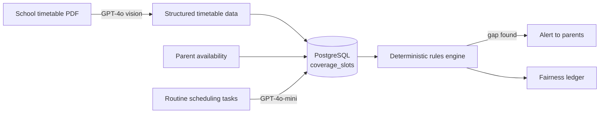

# KidWise AI

**An AI-powered school & parent platform that makes sure no child is ever left uncovered.**

Most family calendars tell you when *adults* have conflicts. KidWise answers a more important
question: **is there a moment when a child has no adult responsible for them?** It reads a school's
timetable, combines it with each parent's availability, and flags any gap before it happens.

> Built end to end by [Shreyas Somani](https://linkedin.com/in/shreyas-somani/), founder and sole developer.

<!-- 📸 Add a demo GIF or 2–3 screenshots here. This is the single most useful thing a reviewer sees.

-->

---

## What it does

| Product | For | Key features |
|---|---|---|
| **Parent app** (Expo / React Native) | Parents | Auto-scheduler, coverage-gap alerts, fairness ledger |
| **School dashboard** (React + Vite) | Schools | School ERP dashboard, timetable upload, class schedules |
| **API** (Node.js + Express + PostgreSQL) | Both | Auth, scheduling, AI ingestion, rules engine, payments |

---

## How the AI is used, and where it deliberately isn't

**1. Document understanding → GPT-4o vision.**
School timetables arrive as PDFs in every possible layout. GPT-4o vision turns them into structured
schedule data that the rest of the system can work with.
<!-- If you validate the LLM output (e.g. a JSON schema / zod check) before saving, say so here. Reviewers love it. -->

**2. Routine scheduling → GPT-4o-mini.**
High-volume, low-difficulty calls go to the smaller model. This keeps cost per request low without
hurting quality.

**3. Safety-critical logic → no LLM at all.**
Detecting when a child is *uncovered* runs in a **deterministic rules engine** built on a `coverage_slot`
data model. An LLM can be wrong in unpredictable ways, and "your child has no one to pick them up" is
not something to get wrong. The rules engine gives the same answer every time and can be unit-tested
and audited.

> **Design principle:** use LLMs to turn messy input into structured data, then use plain, testable code
> to make decisions on that data.

More detail in [`docs/ARCHITECTURE.md`](docs/ARCHITECTURE.md).

---

## Tech stack

| Layer | Choice | Why |
|---|---|---|
| API | Node.js, Express | Fast to build, one language across web and mobile |
| Database | PostgreSQL | Relational data (schools → classes → children → slots) with strong integrity |
| Web | React + Vite | School dashboard |
| Mobile | Expo SDK 54 (React Native) | One codebase for Android and iOS |
| AI | OpenAI GPT-4o (vision), GPT-4o-mini | Right-sized model per task |
| Payments | Razorpay | Indian payments, integrated end to end |
| Hosting | Railway (API), Vercel (web) | Simple deploys for a solo team |

---

## Quality & engineering

- ✅ **80+ passing automated tests**
<!-- Add a line on what the tests cover (e.g. rules engine, auth, payments) once you've checked. -->
- ✅ Razorpay payment flow tested end to end
- 🔒 Children's data: parental-consent architecture designed in line with India's **DPDP Act**

---

## Source code

> The source code is private while KidWise is in active development as a startup.
> I'm happy to walk through the codebase, architecture and tests on a call.

---

## Roadmap

- [x] AI timetable ingestion (GPT-4o vision)
- [x] Coverage-gap rules engine
- [x] Razorpay payments
- [ ] Onboarding flow (signup → add child → add availability → schedule)
- [ ] Role-based access control (school admin / parent / co-parent)
- [ ] SMS OTP (MSG91) and push notifications (Firebase)
- [ ] LLM evaluation benchmark: GPT-4o vs GPT-4o-mini vs Claude on timetable parsing accuracy, latency and cost

---

## Author

**Shreyas Somani**, Founder & AI Developer
[LinkedIn](https://linkedin.com/in/shreyas-somani/) · [GitHub](https://github.com/Shreyas-AiCode) · somanishreyas10@gmail.com
