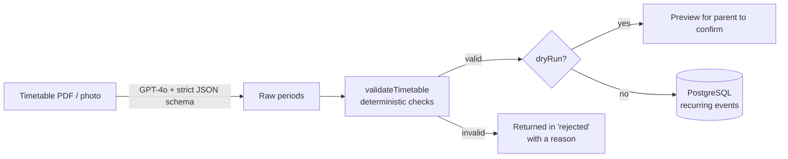

# KidWise AI

**A school-and-parent platform that makes sure no child is ever left uncovered.**

Most family calendars tell you when *adults* have conflicts. KidWise answers a more important question:
**is there a moment when a child has no adult responsible for them?** It holds each child's school
timetable and one-off events, and alerts every linked parent when an event has nobody assigned.

> Built end to end by [Shreyas Somani](https://linkedin.com/in/shreyas-somani/), founder and sole developer.


<!-- 📸 Add a demo GIF or 2–3 screenshots here:  -->

---

## What's built

| Part | Folder | What it does today |
|---|---|---|
| **API** | `backend/` | Auth (bcrypt + JWT, email verification, password reset) · schools, parents, teachers, students · schedules with recurring + one-off events · weekly view · coverage-gap alerts · Razorpay subscriptions + webhooks · **AI timetable import (GPT-4o)** · Swagger docs at `/docs` |
| **Web app** | `frontend/` | Landing page · parent weekly calendar · alerts page · pricing + Razorpay checkout (React, Vite, Tailwind v4) |
| **Mobile app** | `mobile/` | Parent weekly schedule + alerts screens (Expo / React Native) |
| **Shared** | `shared/` | One API client, date helpers and theme used by both web and mobile |

---

## AI timetable import: how the LLM is used, and where it isn't

`POST /schedules/:id/import-timetable` takes a school timetable as a **PDF or photo** and turns it into
weekly recurring events.



1. **The LLM only reads the document.** GPT-4o gets the file plus a strict JSON schema
   (OpenAI Structured Outputs) and `temperature: 0`, so it can only return `{ day, title, startTime, endTime }` periods.
2. **Plain code decides what's saved.** `validateTimetable()` never trusts the model. It checks each period
   for a known weekday, real 24-hour times, end after start and a sensible length (max 6 h), and drops duplicates.
   Anything suspicious is returned in `rejected` with a reason instead of being saved.
3. **Preview before saving.** With `dryRun: true` nothing is written, so the app can show the parent what was
   found and let them confirm.
4. **Cost and reliability are visible.** Every import logs the model, latency and input/output tokens. The model
   is configurable (`OPENAI_TIMETABLE_MODEL`, default `gpt-4o`). Refusals and invalid output return a clear 422,
   and AI outages return a 502, never a crash.

Try it on a real timetable without touching the database:

```bash
cd backend
npm run try:timetable -- path/to/timetable.pdf
```

Tests use a fake AI client, so the suite never calls OpenAI and costs nothing to run.

---

## Coverage-gap alerts (no LLM)

A one-off event with no parent assigned is a **coverage gap**. When one is created, every parent linked
to that child gets an alert (once per parent, so it's safe to re-run). This is simple, deterministic and fully
tested. Push delivery is currently logged to the console as a placeholder for Firebase Cloud Messaging.

---

## Tech stack

| Layer | Choice |
|---|---|
| API | Node.js, Express, Prisma 7 (pg adapter), PostgreSQL |
| Auth | bcrypt password hashing, JWT sessions, email verification codes |
| AI | OpenAI GPT-4o (PDF + vision input, Structured Outputs) |
| Web | React, Vite, Tailwind CSS v4, React Router |
| Mobile | Expo SDK 54 (React Native) |
| Payments | Razorpay (test mode): orders, Checkout signature verification, HMAC-verified webhooks |
| Docs | OpenAPI / Swagger UI at `http://localhost:4000/docs` |
| Tests | `node:test` + supertest: **94 tests** across auth, CRUD, schedules, alerts, payments and AI import |

---

## Running locally

**You need:** Node.js 20+, PostgreSQL 15+, and optionally an OpenAI API key (for AI import) and Razorpay
test keys (for payments). Use the Expo Go app to open the mobile app on your phone.

```bash
git clone https://github.com/Shreyas-AiCode/Kidwise.git
cd Kidwise

# 1. API → http://localhost:4000 (docs at /docs)
cd backend
cp .env.example .env            # fill in DATABASE_URL, JWT_SECRET, and optional keys
npm install
npx prisma migrate deploy       # create the database tables
npm run db:seed                 # demo parent + student + sample schedule
npm run dev

# 2. Web app → http://localhost:5173
cd ../frontend
npm install
npm run dev

# 3. Mobile app (Expo)
cd ../mobile
npm install
npx expo start
```

Run the tests (they need the database from step 1):

```bash
cd backend && npm test
```

> The Razorpay tests create real **test-mode** orders, so they need valid `rzp_test_` keys in `.env`.

---

## Roadmap

- [x] Auth, school/parent/student data model, schedules and weekly view
- [x] Coverage-gap alerts
- [x] Razorpay subscriptions (test mode)
- [x] AI timetable import (GPT-4o + validation + dry-run preview)
- [ ] Timetable upload screen in the web and mobile apps
- [ ] Auto Scheduler: suggest which parent covers each gap
- [ ] Fairness Ledger: track who covered what between parents
- [ ] Role-based access control (school admin / parent / co-parent)
- [ ] Real push notifications (Firebase) and SMS OTP (MSG91)
- [ ] Parental-consent flow for children's data in line with India's DPDP Act
- [ ] Evaluation benchmark: GPT-4o vs GPT-4o-mini vs Claude on timetable accuracy, latency and cost

---

## Author

**Shreyas Somani**, Founder & AI Developer
[LinkedIn](https://linkedin.com/in/shreyas-somani/) · [GitHub](https://github.com/Shreyas-AiCode) · somanishreyas10@gmail.com
