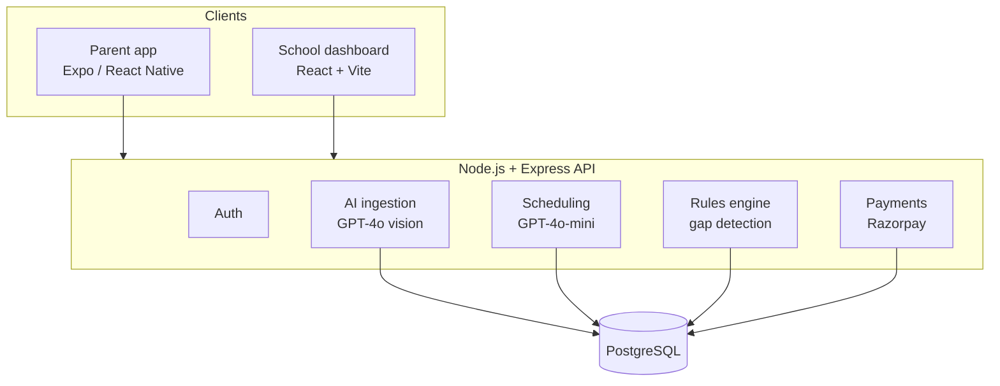

# KidWise AI: Architecture notes

These notes explain the main design decisions and the reasons behind them.

## 1. The core idea: `coverage_slot`

Everything in KidWise is built around one data primitive: a **coverage slot**. It is a block of time
in a child's day, with a record of who (if anyone) is responsible for the child during it.

- A school period is a slot covered by the school.
- A pickup window is a slot that needs a parent or guardian.
- A slot with **no responsible adult** is a **gap**, and finding gaps is the product.

This turns a fuzzy question ("is everything okay this week?") into a precise one that code can answer:
*"Is there any slot for this child with zero responsible adults?"*

## 2. Where AI is used

| Task | Model | Reason |
|---|---|---|
| Reading timetable PDFs (tables, scans, odd layouts) | **GPT-4o (vision)** | Needs strong visual + layout understanding; low volume, so cost is acceptable |
| Routine scheduling tasks | **GPT-4o-mini** | High volume, simpler task, so the cheaper, faster model fits |
| Gap detection | **No LLM, rules engine** | Must be correct, repeatable and testable |

**Why PDF upload instead of reading parent WhatsApp groups?** WhatsApp group chats can't be read
reliably through Meta's APIs, so school PDF timetables are the dependable ingestion path.

## 3. Why the rules engine is deterministic

LLMs are great at turning messy input into structure. They are a poor fit for decisions where a wrong
answer has real consequences and where you need the same answer every time. So:

1. **AI** converts messy input (PDFs) into structured `coverage_slot` data.
2. **Plain code** decides whether a gap exists.

The benefits are predictable behaviour, easy unit testing, zero per-check AI cost, and logic you can
explain to a parent or a school.

## 4. System overview

## 5. Data protection

KidWise handles children's data, so consent is designed in from the start. The parental-consent
architecture is being designed in line with India's **Digital Personal Data Protection (DPDP) Act**.
Secrets (API keys, database URLs, payment keys) live only in environment variables and are never
committed.

## 6. Hosting

- API → Railway
- Web dashboard → Vercel
- Mobile → Expo (development builds on device)
